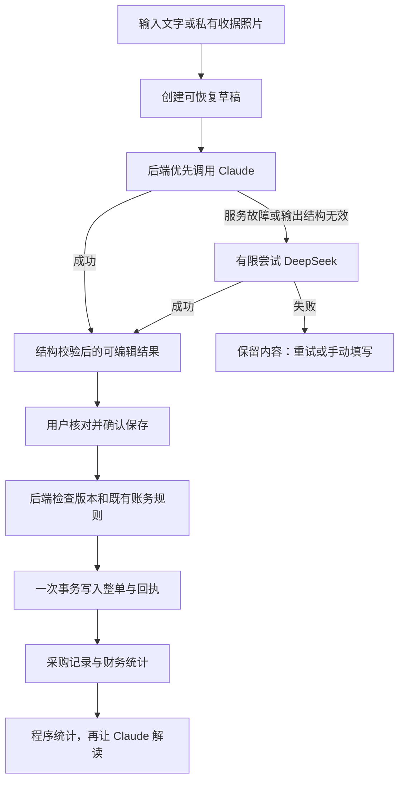

# AI 记成本 · 落地方案概览

这次的重点是让老板少填表：买完东西，说一句或拍收据；系统先整理，你核对后再记账。原来的精细用料功能继续存在，日常采购不用先了解批次和库存。

## 用户实际会怎么用

| 输入 | 整理结果 | 用户最后做什么 |
| --- | --- | --- |
| 今天买了葱10块，都付了 | 葱／配料／RM10／已付；数量空 | 核对，点保存 |
| 今天买了肉碎32、煤气35 | 食材采购32＋日常开支35；付款待确认 | 选已付或待付，可逐项修改 |
| 一张54令吉、优惠2令吉的收据 | 逐行列项目，优惠只分摊一次，合计52 | 对照原图，修改后保存 |
| 收据认错一个数字 | 高亮与收据总额的差异 | 改正，或填写原因后采用修改总额 |
| 这个月主要花在哪 | 程序统计分类金额，AI解释并列依据 | 查看对应记录，决定是否调整采购 |

没有数量时，系统记的是「采购成本支出」。之后补数量、开封和用完时间，才逐渐拥有更准确的用料资料；不能因为买了一包盐就声称所有食材成本已经算准。

## 页面怎么安排

主导航「食材与用料」改成「AI 记成本」，内部只有三个页签：

- **记一笔**：一句话输入、大按钮拍照／上传、少量示例。进阶用料入口折叠在下方。
- **采购记录**：找得到每笔采购、付款状态、原话／原图；可以给已有采购补数量。
- **开销分析**：先看总额、已付、待付和分类分布，再点问题生成解读。

核对页电脑左边原始资料、右边可编辑项目；手机默认收起来源，直接进入明细卡。底部始终有「共几项、合计、确认保存」，每一项默认只看名称、分类、金额。

保存成功告诉用户这笔进了哪里，例如「2项食材采购、1项日常开支」。不是弹一段技术信息，也不要求理解库存建模。

## 后台怎么连接

Claude和DeepSeek的API key放Firebase后端Secret Manager，浏览器只与本系统通信。没有key也能先完成代码与模拟验收；真实识别效果需要配置后用实际收据测，不预先承诺准确率。

模型只提供建议字段，不直接写账。金额重算、折扣分摊、关账限制、月租归属、欠款结清、库存关联和回本口径都由程序掌握。

## 用起来简单，账务必须稳

| 情况 | 设计处理 |
| --- | --- |
| 保存时多点两下／断线后重试 | 同一草稿只生成一组账目，恢复原回执 |
| 不记得数量 | 先记录真实采购支出，之后补资料不再计一笔钱 |
| 没说明是否付款 | 留待用户确认，不擅自当已付 |
| 两个页面同时修改 | 提示版本冲突，不悄悄覆盖 |
| 主模型不可用 | 后端按条件切备用；用户不必选模型 |
| 两家都不可用 | 原文、图片和修改保留；仍能手动填 |
| 同张收据再上传 | 提示原记录，可查看；确实另一笔需说明 |
| 没有用量数据 | 能分析采购开销，不能断言真实消耗、剩余和浪费 |

## 分三段开发，逐段验收

1. **文字到真实入账**：主备接口、草稿编辑、明确付款、一次性保存，与原财务统计连接。
2. **照片与记录管理**：私有上传、收据金额核对、来源回查、草稿恢复、重复提醒、补数量。
3. **开销分析与上线**：真实统计、证据解读、缓存与限额、真实收据验收、按店开启功能。

不新增聊天机器人、自动换汇、供应商自动付款或自动算损耗。这些不属于当前日常成本录入的必要流程。

## 如何控制调用与运行成本

用户点整理才调用模型，改字段与合计由本地／后端程序计算，不每改一个金额就调一次。成功草稿可以恢复，不因刷新再识别；同一份账本摘要的解释可缓存，账目变化后失效。

服务端设总截止时间、每日调用上限及图片大小限制；默认每家最多一次，不因一张模糊票反复烧额度。记录真实token和调用次数，按实际选用模型的官方价格核算。照片存储、Functions和Firestore用量单独计量。

正式开发时再配置两家key和当前可用模型；先在既有 `wantan-staging` 目标按明确部署指令小范围验收，通过后再决定扩大使用。

本次已交付设计、可点击原型、实施计划和Claude prompt。没有修改正式业务功能、调用供应商API或发布新的云端AI功能。
