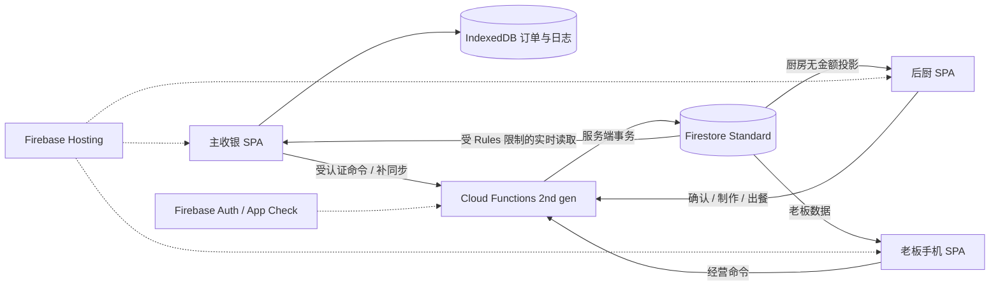

# 03 · Google 架构、数据库与部署设计

## 1. 选型与备选

推荐保留现有SPA，Firebase Hosting承载静态站；Auth身份、Firestore Standard数据库、Cloud Functions 2nd gen执行受信任命令；浏览器IndexedDB保存离线交易日志。Hosting适合静态和SPA，无需为了上线迁移Next.js。[Hosting官方说明](https://firebase.google.com/docs/hosting)

备选二：Cloud Run + Cloud SQL/PostgreSQL，约束和关系报表更自然，但首版要多维护数据库、连接、备份与实时通道。备选三：本地边缘服务 + 云端同步，能支持无互联网局域网POS/KDS互通，但增加本地硬件与双端冲突。用户选择单台设备离线接单，因此首版不引入边缘服务器；未来要求断网跨设备实时互通再单独设计。

Google全家桶不等于全部Google产品都要启用。Sheets适合导出，BigQuery适合将来大规模分析，Gemini API不是首版营业依赖。Cloud Storage仅在票据附件/备份导出需要时启用。



区域建议Firestore和Functions均 `asia-southeast1`（新加坡），适合柔佛访问；这是地理与架构判断，实际延迟需实测。两项服务支持该区域，Functions客户端也必须显式指定同一区域。[Firestore位置](https://docs.cloud.google.com/firestore/docs/locations)、[Functions位置](https://firebase.google.com/docs/functions/locations)

## 2. 必须守住的不变量

1. 任何已收款的本机订单先持久化，UI才声明成功；云端ack之前不删除恢复材料。
2. 同一个业务命令重复执行，无新增第二张订单、支付、退款、成本或审计事件。
3. 同一实体餐牌最多一个当前持有订单；离线冲突必须显式核对。
4. 售价、BOM、汇总在服务器重新验证；前端传入的总价不是权威。
5. 所有正式交易写入经Functions；Web SDK只读，个人偏好也先本地保存。
6. 制作、付款、同步、餐牌分别建模，不能用一个 `status` 代表全部。
7. 后厨可读文档不含价格、付款、成本；收银可读文档不含BOM和利润。
8. 生产没有演示自动注入、清空数据按钮、`allow read,write: if true`。
9. 离线订单补同步不自动送厨；已人工出餐不能重新进入待下锅。
10. 关账快照不可静默改变；迟到交易和更正必须可追溯。

## 3. 数据约定

- 单店根路径 `stores/{storeId}`；业务文档ID使用UUID，不把餐牌号用作订单ID。
- `schemaVersion`每份交易都存。金额整数sen，成本整数0.1sen，不能混用；字段后缀为 `Sen` / `CostUnits`。
- 数量正整数；面球用整数 `noodleHalfUnits`（1面球=2），云吞用整数。
- 服务器Timestamp与本机估计时间分开；`businessDate`由后端营业时区/切点或经过核对的离线事件决定。
- 菜单/价格/BOM采用不可变版本；订单固化名称、规格、规则与价格版本，历史订单不因改价漂移。
- 不存不必要顾客个人资料；备注80字、原因200字，输出/CSV均按不可信文本处理。

### 3.1 集合清单（均在 `stores/{storeId}/` 下）

| 路径 | 关键字段 | 读取 |
|---|---|---|
| `config/public` | name,currency,timezone,cutover,activeMenuVersion,receipt,qrPayee | 门店成员 |
| `config/finance` | initialCapitalSen,openingProfitSen,fixedCostPolicy | 老板 |
| `members/{uid}` | role,active,displayName | 本人/老板 |
| `devices/{deviceId}` | role,authUid,registerId,epoch,active,lastSeenAt,appVersion | 老板；本人设备 |
| `operationsStatus/current` | kitchenLastSeenAt,kitchenActiveCount,activeRegisterId | 收银/老板/厨房 |
| `menuVersions/{version}` | publishedAt,products,allowedModifiers,prices,soldOut,visualCatalogVersion | 收银/老板；不含BOM |
| `visualCatalogs/{version}` | assetManifest,productPhotoIds,noodlePhotoIds,pictogramIds,contentHashes | 门店成员；本地缓存 |
| `bomVersions/{version}` | effectiveAt,recipes,unitCosts | 老板 |
| `registers/{registerId}` | activeDeviceId,epoch,lastAppliedSequence,shiftId | 主收银/老板 |
| `orders/{orderId}` | 交易及制作事实，见下 | 收银/老板 |
| `orderCosts/{orderId}` | bomSnapshot,totalCostUnits,costAllocationEvents | 老板 |
| `kitchenTickets/{orderId}` | 无财务的厨房投影，见下 | 厨房/收银/老板 |
| `tokens/{01..50}` | state,orderId,version,updatedAt | 收银/老板；厨房不直接释放 |
| `payments/{paymentId}` | orderId,method,amountSen,confirmedBy,paidAt,businessDate,tenderedSen,changeSen | 老板；收银用受控订单摘要 |
| `refunds/{refundId}` | orderId,originalPaymentId,amountSen,method,reason,confirmedBy,refundedAt,businessDate | 老板 |
| `expenses/{id}` | category,amountSen,paidSen,paymentSource,businessDate,accrualPeriod,status | 老板 |
| `wastage/{id}` | quantities,costUnits,bomVersion,linkedOrderId,alreadyAllocated,status,businessDate | 老板 |
| `cashMovements/{id}` | shiftId,type,amountSen,source,occurredAt,businessDate | 老板 |
| `shifts/{id}` | registerId,openedAt,openingFloatSen,status,offlineCapabilityExpiresAt | 收银/老板 |
| `dailyReports/{date}` | latestVersion,closedAt,status | 老板 |
| `dailyReports/{date}/versions/{n}` | immutableSummary,ledgerWatermark,exceptions,closedBy | 老板 |
| `dailyStats/{date}` | versionedDerivedSummary,updatedAt,sourceWatermark | 老板 |
| `businessDays/{date}` | state(open/closing/closed),ledgerWatermark,latestReportVersion | 老板；Functions写入屏障 |
| `offlineInbox/{eventId}` | device,epoch,sequence,payloadHash,payload,status,result,reason | 老板；本人主收银 |
| `operations/{operationId}` | type,actorUid,payloadHash,result,committedAt | Functions；客户端走查询接口 |
| `auditEvents/{eventId}` | actor,device,action,entityId,beforeVersion,afterVersion,reason,time | 老板 |

支付详情不暴露给整个收银用户集合；收银所需「已收/退款待处理/方式/金额」在订单摘要返回。厨房投影不能通过展开子字段读到成本；Firestore读取权限是文档级，不能依靠Rules只隐藏同文档的部分字段。[字段访问限制](https://firebase.google.com/docs/firestore/security/rules-fields)

### 3.2 订单类型契约（示意，不是现有代码）

```ts
type ProductKind = 'dry_noodle' | 'soup_noodle' | 'dry_wanton' | 'wanton_soup';
type Fulfillment = 'queued' | 'preparing' | 'served' | 'cancelled';
type PaymentState = 'paid' | 'refund_due' | 'refunded';
type LocalSyncState = 'local_only' | 'submitting' | 'unknown_result'
  | 'uploaded' | 'accepted' | 'needs_review';

interface OrderDocument {
  schemaVersion: 2;
  storeId: string;
  id: string;                  // clientOrderId，稳定UUID
  receiptNumber: string;       // 云端业务票号，另有离线原号
  offlineReceiptNumber: string | null;
  tokenNumber: number;         // 原实体牌，不静默改号
  serviceMode: 'dine_in' | 'takeaway';
  source: 'online' | 'offline';
  kitchenRouting: 'digital' | 'manual';
  fulfillmentStatus: Fulfillment;
  paymentState: PaymentState;
  kitchenCancelRequested: boolean;
  items: OrderLineSnapshot[];  // 名称/规格/有效modifiers/数量/售价，无BOM
  totalSen: number;
  paidSen: number;
  refundedSen: number;
  paymentMethod: 'cash' | 'qr_manual';
  acceptedAtEffective: Timestamp;
  deviceAcceptedAtMs: number | null;
  cloudReceivedAt: Timestamp;
  startedAt: Timestamp | null;
  servedAt: Timestamp | null;
  kitchenAckAt: Timestamp | null;
  timeQuality: 'server' | 'device_estimated' | 'reviewed';
  businessDate: string;
  menuVersion: string;
  registerId: string;
  registerEpoch: number;
  shiftId: string;
  createdBy: string;
  version: number;
}
```

`OrderLineSnapshot`必须有lineId、productKind、size、noodleType(thin_egg/mee_poh/null)、sauce或null、isKosong、有效modifiers、unitPriceSen、quantity、noodleHalfUnits、wantonCount、nameZh/nameEn、note、photoId、pictogramIds、visualCatalogVersion。图像字段由服务端按有效配置映射，不允许客户端用图掩盖实际配置；历史订单引用版本化素材。禁止未定义字段、负数量、未知枚举和任意单价。`LocalSyncState`只在本机/同步结果，不能作为云端已接纳的证明。

`kitchenTickets`仅含orderId、token、serviceMode、纯制作行（含面种、photoId、pictogramIds）、数量、制作状态、kitchenRouting、effective时间与时间质量、取消请求、version；保留所有未完成订单跨营业日显示，完成后默认仅查询当前营业日记录与最近撤回窗口。其余历史分页，不监听整库。图卡是本地/versioned素材，不在订单存图片base64。

## 4. 权限模型

Auth确认身份；门店成员文档决定角色；Functions每个命令重查成员有效性和设备/epoch，不只信任前端或过期custom claims。Admin SDK绕过客户端Rules，因此服务端必须显式校验storeId、成员、参数、状态和权限。

Rules默认拒绝；逐个集合开放有界读取，所有客户端交易写入拒绝。查询必须匹配规则可证明的条件；Rules不是返回数据后的过滤器。所有 `stores/{id}` 路径都验证对应门店，不能只验证登录。

厨房账号不能读 `orders/payments/orderCosts/expenses/dailyStats/config/finance`；收银不能读成本、退款流水、老板统计。owner也不能用Web SDK直接改交易。成员新增/角色更改只有owner命令；bootstrap用管理员脚本初始化第一个owner，禁止公开“注册成为老板”接口。

App Check用reCAPTCHA Enterprise先监测合法域名与设备，再启用Functions/Firestore的对应强制校验；它补充而不替代身份与角色。测试使用debug配置，生产不得带debug token。[App Check配置](https://firebase.google.com/docs/app-check/web/recaptcha-enterprise-provider)

注销清理订阅和本机敏感显示；持久化交易日志有未同步时先提醒/导出，不能直接擦掉。厨房可默认使用内存Firestore缓存；POS交易日志用独立IndexedDB，不依赖Firestore写缓存实现收单。

## 5. 命令API

使用HTTPS Callable；SDK携带Auth/App Check信息，但业务权限仍由处理函数检查。[Callable官方说明](https://firebase.google.com/docs/functions/callable)

所有写命令统一参数：`storeId, operationId, deviceId, expectedVersion?`。POS命令另外携带 `registerId, epoch, sequence, shiftId`。相同operationId+相同标准化payload返回原结果；同ID不同payload返回冲突。收银日志序号跨在线/离线连续，设备本地原子递增；服务端按序应用，缺号不能越过依赖。

| 命令 | 谁 | 输入/前置条件 | 原子结果 |
|---|---|---|---|
| `openShift` | 收银主机/老板 | 联网、有效主机、备用金 | 班次/离线资格/配置快照 |
| `createOrder` | 主收银 | 稳定ID、菜单版本、行、餐牌、已确认收款信息 | order/payment/orderCosts/token/ticket/audit/operation同事务 |
| `getOperationResult` | 原操作者/老板 | operationId | 原结果/未找到/待核对，不发生写入 |
| `ackKitchenTicket` | 厨房 | ticketId/version | 首次收到时间；重复不改首次时间 |
| `startOrder` | 厨房 | queued/version | preparing + startedAt + 投影 + 审计 |
| `serveOrder` | 厨房 | preparing或queued/version | served + servedAt + token awaiting_return + Undo事件 |
| `undoServe` | 原厨房操作者/老板 | 30秒内、原锁、未关账、version | 恢复之前queued/preparing及时间，保留事件 |
| `requestCancel` | 收银/老板 | queued/preparing、原因/version | queued直接取消；preparing设取消请求 |
| `confirmKitchenCancel` | 厨房/老板 | 制作中取消请求、消耗说明 | cancelled、退款待处理、成本处理 |
| `confirmFullRefund` | 老板 | 实际已退款、原payment、原因、退款方式 | 单次整单refund+payment摘要+审计；不调用银行 |
| `releaseToken` | 主收银 | 原orderId、牌待回收、version、实体已回收 | 牌available，保留原订单 |
| `syncOfflineEvents` | 原主机/老板 | 有序日志批次 | inbox持久收件；逐事件接纳/待核对 |
| `completeManualOrder` | 主收银/老板 | 人工单、真实出餐时间/version | 人工已出餐，不触发电子新单 |
| `routeManualOrderToKitchen` | 主收银/老板 | 人工未做、核对说明/version | routing digital+投影、KDS醒目标识 |
| `recordExpense/Wastage/CashMovement` | 老板 | 规范字段、归属日期、成本去重 | 账本事件+审计 |
| `closeBusinessDay` | 老板 | 冻结屏障、零未同步/冲突、核对说明 | 固定版本日结 |
| `restateBusinessDay` | 老板 | 迟到事件/调整、原因 | 新快照版本，保留旧版本 |
| `publishMenu/Bom` | 老板 | 完整合法版本、未来生效 | 新不可变版本+生效配置 |
| `heartbeatDevice` | 设备本人 | 有效会话、岗位 | 限频更新lastSeenAt及运行状态投影 |
| `manageMember/assignRegister` | 老板 | 联网、原因、待同步检查 | 成员/设备epoch变更+审计 |

错误使用Callable标准码，并在details中传稳定 `reasonCode`：TOKEN_OCCUPIED、STALE_VERSION、INVALID_MODIFIER、MENU_CHANGED、REGISTER_REVOKED、SEQUENCE_GAP、DAY_CLOSED、OFFLINE_REVIEW_REQUIRED。UI根据码翻译，不能直接展示堆栈。

## 6. 在线事务与幂等

`createOrder`事务步骤：先读operation、成员与register、shift、菜单/BOM、token、营业日写入屏障/汇总水位；已存在同payload结果则返回。验证价格与规则，已过期价格要求收款前重新确认；已经真实收到钱却发生冲突，进入待核对而不丢弃本机收款事实。

Firestore事务要求读在写之前，遇并发可能重试，客户端离线事务会失败；所以事务回调不得触发音效、打印、付款或其他副作用。[事务官方说明](https://firebase.google.com/docs/firestore/manage-data/transactions)

按固定文档ID一次写订单、支付、私有成本、牌锁、厨房投影、操作结果和确定ID审计事件；序号/票号只在成功事务中推进。成本/计数的增量以事件ID去重。后厨确认与实际出餐是独立命令，不作为创建事务成功条件。

仅在事务提交确认后通知UI；网络超时先查询原operation，然后同payload重试。**在线提交结果不明的订单不能直接改成新的离线人工单**：它可能已在厨房屏出现，先标 `unknown_result`，联系厨房核对后再人工处理，并保留原ID。恢复网络发现已是digital订单时，只合并原结果，不能再次创建manual订单。

批次汇总前端从授权厨房投影纯计算，不每秒写数据库。时间计数同样本地计算。后厨状态与订单投影在同一业务事务更新，首版不靠异步触发器维持关键一致性。

## 7. 离线日志与同步协议

### 7.1 IndexedDB表

`drafts`（草稿）、`localOrders`（完整已提交本机订单）、`outbox`（不可变操作日志）、`localTokens`（牌状态）、`configCache`（菜单规则/角色/班次/服务器时间校准）、`syncResults`（云端映射与状态）、`deviceState`（UUID、epoch、lastSequence）。

本机新单事务同时写localOrder/outbox/token/sequence；任意失败整次回滚。使用可靠的IndexedDB封装即可，不引入多个状态框架。申请浏览器持久化存储是辅助，不能承诺永不被清除。每次提交捕获QuotaExceededError，记录失败不得在UI假成功。

客户端离线缓存会在联网时同步，且同文档并发可能last-write-wins；这不等于业务幂等，也不等于局域网互通。因此这里使用命令日志和服务端验证。[Firestore离线行为](https://firebase.google.com/docs/firestore/manage-data/enable-offline)

### 7.2 事件信封

```json
{
  "eventId": "UUID",
  "operationId": "UUID",
  "storeId": "pontian-main",
  "registerId": "front-01",
  "deviceId": "UUID",
  "registerEpoch": 3,
  "sequence": 143,
  "shiftId": "UUID",
  "type": "offline_order_created",
  "occurredAtDeviceMs": 1792638000000,
  "lastServerOffsetMs": 120,
  "menuVersion": "menu-v2",
  "payload": { "clientOrderId": "UUID", "tokenNumber": 18 },
  "payloadHash": "sha256-of-canonical-payload"
}
```

上例是字段形状示意，真实payload必须包含全部餐品/收款/人工交接信息；hash由服务器重新计算，不能把客户端hash当身份签名。

`offline_order_created / manual_handoff / manual_served / token_returned`为不可变追加事件。修改订单必须是新事件，不能悄悄改已上传原payload。相同order可先离线出餐回收再离线开下一单，序号保证先回收旧牌再占用。

### 7.3 重连算法

1. 主界面检测实际Functions/授权可达；浏览器online只作提示。重新验证成员、主机epoch与班次。
2. 先查询所有unknown_result的在线命令；已云端成功的合并原结果，不按新离线单导入。
3. 上传日志到inbox，建议每批≤25事件、≤200KB。每条以eventId幂等收件，返回uploaded并不代表accepted；原主机失效仍可在身份/门店权限有效时提交供owner核对，不能自动应用。
4. 同设备按sequence读取应用；缺号暂停依赖事件。非依赖项可接纳，但不得跨过同一餐牌/订单的状态前置依赖。首版可以保守阻塞整条设备流，界面显示阻塞事件和影响金额。
5. 为避免制作闪现，按同order已收件事件折叠最终人工状态，再用事务导入；即使只先导入创建事件，也必须routing=manual、主KDS不显示。manual_served/import从不触发新厨单音效。
6. 服务端用不可变历史菜单验证售价，匹配当时BOM版本计算私有成本。已按缓存旧价成交的有效离线单按旧价入账，显示版本差异；不追收差额。不存在版本或非法字段进needs_review。
7. 接纳同事务写order/payment/cost/token/operation/inbox结果/audit/水位；重复重放返回相同orderId/paymentId与序号结果。
8. 单条冲突保留inbox与本机记录，owner核对实际牌、金额和厨房状态后发新的解决事件；原事件不覆盖。允许明确“牌已回收、仅补历史账”，保留原牌号但不抢占当前新订单牌锁。
9. 本机仅在accepted后更新云端标志；至少保留最近30天已同步本机恢复记录，未同步/待核对无自动过期删除。导出恢复包按eventId重入也幂等。

### 7.4 离线时间与关账

采样服务器时间偏移记录，离线用设备时间加最近偏移估计；超过5分钟疑似偏差、超出班次24小时或明显回拨，标needs_review。估计时间订单默认不参与出餐SLA；老板复核后可变reviewed，保留原始值与理由。

当日未同步统计由主收银心跳上报outbox未接纳数量及金额，不把上报值当正式账；心跳过期无法确认清零时禁止关账，老板异常override必须列明风险并生成审计。已关闭日收到迟到事件持久收件但待更正，不静默插入冻结版本。

## 8. 报表、索引与关闭屏障

首版老板按日期分页读取权威账本、纯函数聚合，不加载全部历史到所有设备。dailyStats是可重建缓存，不能当唯一账本。更新可选同事务增量，或后台幂等任务；若用Firestore触发器必须按eventId去重，并提供重建/核对命令，不能默认“触发一次”。

建议复合索引：

| 集合 | 字段 |
|---|---|
| orders | businessDate ASC, acceptedAtEffective DESC |
| orders | fulfillmentStatus ASC, acceptedAtEffective ASC |
| kitchenTickets | kitchenRouting ASC, fulfillmentStatus ASC, acceptedAtEffective ASC |
| kitchenTickets | businessDate ASC, fulfillmentStatus ASC, servedAt DESC |
| payments/refunds/expenses/wastage/cashMovements | businessDate ASC, occurredAt DESC（各账本统一必需事件字段） |
| offlineInbox | registerId ASC, sequence ASC |
| offlineInbox | status ASC, receivedAt ASC |

实现时所有账本补统一 `occurredAt` 字段，避免表中通用字段与真实查询不一致；同一字段定义写入共享schema。索引以实际查询测试生成 `firestore.indexes.json`，单字段索引不重复创建；大段备注/原始日志payload可豁免不必要索引。

关账：写入businessDays控制文档进入closing，所有会影响该日账本的命令事务必须读此屏障；提交版本读水位确保没有新交易越过。closing期间不能无提示丢弃已收款订单，收件箱保留，作为迟到待调整。关账快照使用权威账本和人工盘点，不使用浏览器图表数字直接提交。

跨日仍在制作的订单不阻止新日开档，厨房查询不按今日截断；财务按收款/退款/成本事件对应日期处理。

## 9. 项目结构建议

```text
src/
  app/                  # 路由、Auth、门店、布局
  features/pos/
  features/kitchen/
  features/orders/
  features/owner/
  features/sync/
  components/ui/        # 业务无关组件
  domain/               # 菜单、规则、金额、时效纯函数
  data/firebase/        # 初始化、只读订阅、Callable封装
  data/local/           # IndexedDB、日志、恢复
  i18n/                 # 类型安全中英字典
packages/contracts/     # 前后端共享schema/DTO，无浏览器依赖
functions/src/
  commands/             # 权限校验、事务写入
  domain/               # 共享领域规则的服务端入口
  reports/              # 聚合、重建、关账
  offline/              # 收件、校验、重放、核对
  auth/                 # 初始化owner、成员/设备
firestore.rules
firestore.indexes.json
firebase.json
.firebaserc.example
tests/                  # domain/rules/emulator/e2e
```

不要先大规模改目录再做业务。先为现有纯函数补用例，逐步抽离1300行POS和1180行Analytics。保留原测试覆盖的正确规则，明确改掉与新规格冲突的期望。

## 10. 部署与环境

项目：本地Emulator、`dev/staging`真实Firebase项目、`prod`独立项目。预览站只能连接测试数据库；Hosting预览频道不会自动隔离数据库。`.env.example`列出Firebase Web配置和Functions region，不含服务账号私钥。

首次需要Firebase/Google账号、项目ID、Blaze计费、授权域名、Firestore区域、owner邮箱、门店名/二维码。缺这些时Claude仍须交付本地可运行代码、Emulator脚本、Rules、索引和部署说明，不能假装已上云。

Cloud Functions等使用按量计费；不要承诺免费。设置预算告警，降低空闲实例成本，按压测设maxInstances。预算告警本身不会限制总费用；部分Firebase服务当前可设置spend caps，但触顶可能暂停营业相关服务，需结合人工营业预案决定，且不视为Firestore等所有服务的统一硬上限。[计费方案](https://firebase.google.com/docs/projects/billing/firebase-pricing-plans)、[预算与上限](https://firebase.google.com/docs/projects/billing/spend-caps)

小档口估算模板而非报价：若每日200单、30天，则6000单/月；若每单5次命令则约30000次/月，按实际订单/投影/日志/监听读写放大计算Firestore费用；两台厨房每60秒一次心跳、每日12小时则约43200次/月。另算静态流量、函数CPU/内存/冷启动、构建镜像、日志、备份。以所选区域官方计算器与一周真实用量复核，禁止写死“每月RM0”。

初始化命令、部署命令由Claude按最终scripts提供；目标配置应包括Hosting `public:dist`、SPA rewrite到index.html、哈希静态资源长缓存、index.html短缓存、Service Worker更新策略、Auth授权域、Functions region、Rules和索引。Node/SDK版本在实现时核查受支持版本并锁定lockfile，不无依据照搬手册版本号。

Service Worker不缓存Callable响应或Auth接口，不自动重放财务POST。营业中发现新版本只提示，先清空待同步并完成安全检查才刷新；跨版本IndexedDB迁移不得删除outbox。CSP按Firebase/Auth/AppCheck所需域测试，不能为安全头阻断收款登录。

CI：依赖锁定安装→类型/单元→Rules/Emulator→构建→关键E2E→测试环境部署。生产步骤独立受控；优先短期身份/Workload Identity Federation，不在仓库存长期服务账号JSON。部署记录版本、commit、项目ID、迁移、Rules版本和回滚说明。

## 11. 运维与恢复

Cloud Logging使用结构化operationId/orderId/deviceId，隐藏token、凭证、备注敏感内容；Monitoring关注接单失败率、API延迟、后厨心跳、needs_review数量、同步积压、Firestore用量与费用。KDS实时订阅只在前台营业时保持必要范围，退出页面及时unsubscribe。

生产建议配置Firestore每日备份保留14天并做恢复演练；每日备份的具体时间不能精确指定。备份不是收据CSV，后者也不是完整数据库恢复方案。[备份官方说明](https://firebase.google.com/docs/firestore/backups)

恢复演练必须恢复到独立数据库/测试项目，验证订单/支付/退款/牌锁/成员和汇总；确认官方恢复目标、计费及权限后执行，不能直接覆盖生产。函数/Hosting可回滚代码，但数据库schema必须采用向前兼容迁移，不能假设回滚前端会撤销交易数据。

设备丢失：撤销成员/设备资格、递增epoch，旧日志后续只能核对导入；本机未上传且设备丢失的数据无法从云端恢复。开档/交班显示未同步提醒和恢复包，避免给出“绝不丢单”的无条件承诺。
